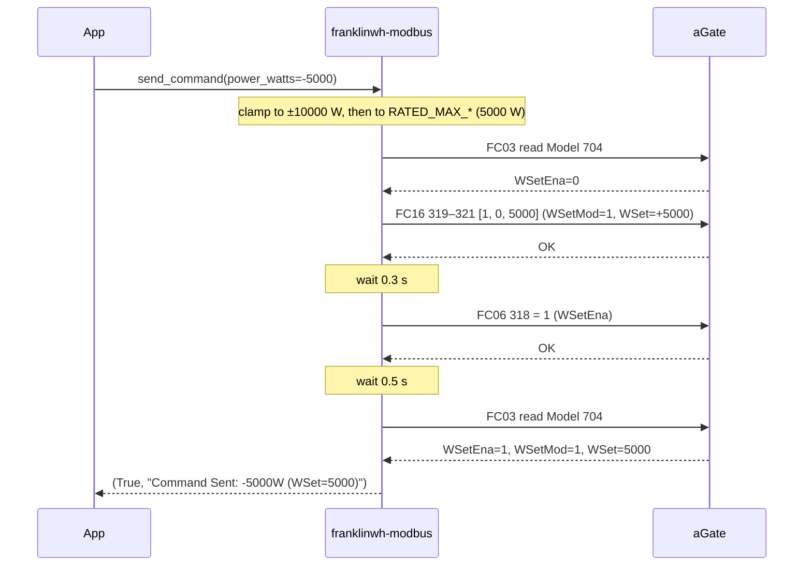
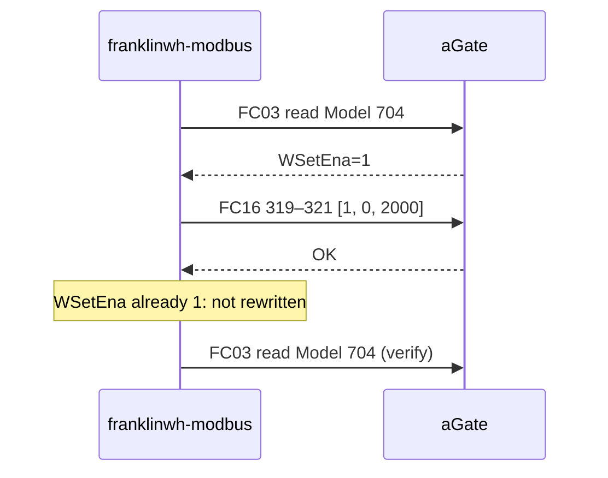
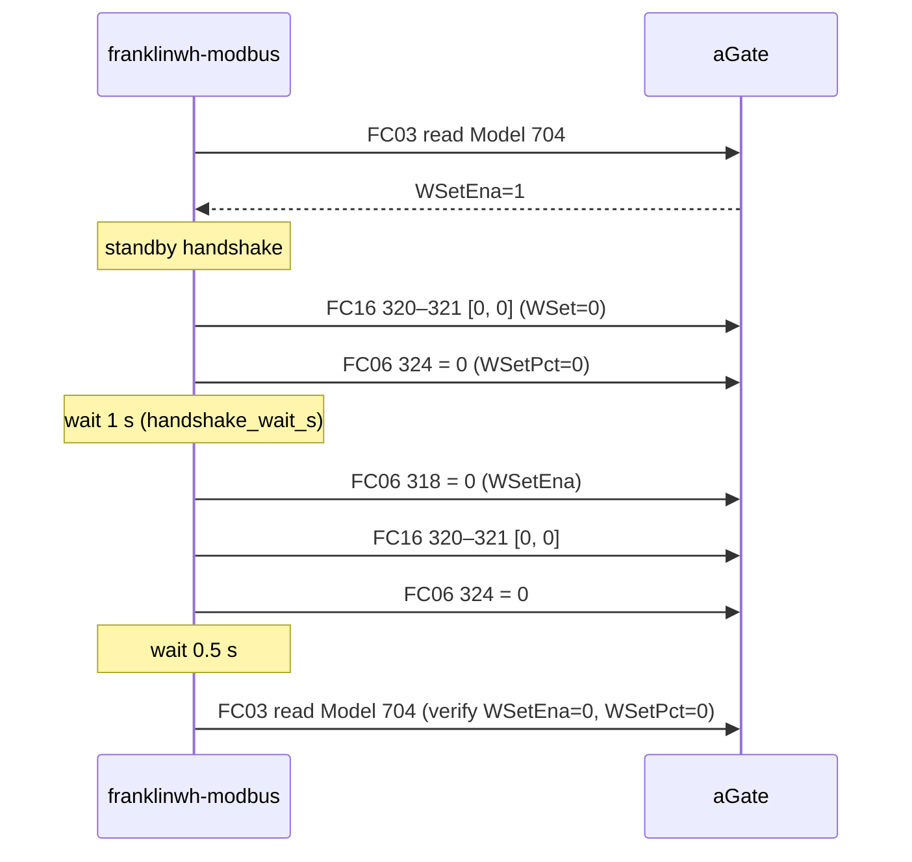
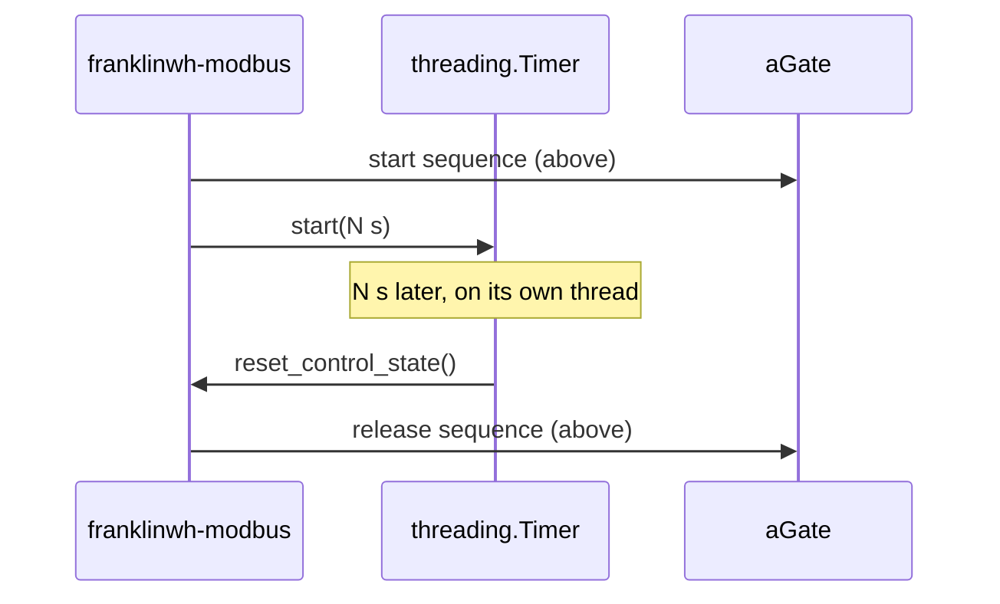

# Battery Dispatch Sequence (0.10.1)

This page lists every register write franklinwh-modbus 0.10.1 makes to start, change, release and time out a battery command. Each step is labelled:

| Label | Meaning |
|---|---|
| **SunSpec** | Standard behaviour. The Model 704 point is cited. |
| **FranklinWH limitation** | The aGate departs from SunSpec, with the firmware and dated evidence. |
| **Workaround** | The library does something SunSpec doesn't call for. Each one says whether the owner approved it, why it exists, and whether it is logged when it runs. |

No workaround on this page has a recorded owner approval. "Merged in PR #N" means the PR was merged; it is not an approval of the workaround itself.

The [guide's §4](FRANKLINWH_MODBUS_GUIDE.md#4-how-to-control-the-battery) shows how to use these calls. This page covers what they send.

## Registers

Model 704 points used, as PDU addresses with the map at base 0:

| PDU | Point | SunSpec meaning |
|---|---|---|
| 318 | `WSetEna` | Set active power enable (0 DISABLED, 1 ENABLED) |
| 319 | `WSetMod` | Set active power mode (0 = percent of `WMax`, 1 = watts) |
| 320–321 | `WSet` | Active power setpoint in W (int32, `WSet_SF`). The model comment says it "may be negative for charging". |
| 324 | `WSetPct` | Active power setpoint in % (int16, `WSetPct_SF`) |
| 326 | `WSetEnaRvrt` | Reversion enable |
| 327–328 | `WSetRvrtTms` | Reversion time, s |

**Addressing on V12R02B60D00.** The aGate also serves the map at base 40000. In the 2026-10-23 live run (`tests/results/live106/live106_20261023T091032Z.log`), pysunspec2's scan used that copy, so the requests went to 40318–40324. The aGate's replies carried 318–324. The diagrams below use base-0 numbers.

## Start: discharge 5000 W

`send_command(BatteryCommand(power_watts=-5000))` with control off. The frames are from the 2026-10-23 live run on V12R02B60D00.



| Step | Label | Detail |
|---|---|---|
| Clamp to ±10000 W (`types.py:56–66`) | Workaround | Not approved. Why: "device has no input validation (PICS Issue 5)"; firmware not stated. Logged: warning, only when it clamps. |
| Clamp to `RATED_MAX_CHARGE_W` / `RATED_MAX_DISCHARGE_W` (`controller.py:1504–1525`) | Workaround | Not approved; direction fix merged in PR #29. The ratings come from M702 `WChaRteMaxRtg` / `WDisChaRteMaxRtg`, or 5000 W if Model 702 is missing or reads 0 (`discover_ratings`, 1447–1489). They do not come from `WMax`, the reference SunSpec defines for percent, because the aGate reads `WMax` = 0. Logged: warning when it clamps or falls back. |
| Sign: `WSet` = −`power_watts` (`controller.py:1589`) | Workaround | A translation from the library's convention (+ = charge) to the device's (+ = discharge). Not approved. Measured on V12R02B60D00: `WSet` +5000 gave M714 `DCW` +5000 W, battery discharging (c8, 2026-10-23, 3 of 3). Logged: no. |
| `WSetMod`=1 and `WSet` in one FC16 | SunSpec | 319–321 are contiguous, so one request carries both. |
| Watts through `WSet`, never `WSetPct` | Workaround | Merged in PR #106 (2026-10-23); no explicit approval found. Why: V12R02B60D00 refuses `WSetPct` above raw 100 (10 %); see [Percent limits](#percent-limits-by-firmware). The device also departs from SunSpec here: `WSet` above 10 % works while `WSetPct` doesn't. Logged: debug "Command sent: WSetMod=1, WSet=…, WSetEna=1". |
| `WSetEna`=1 after the setpoint, only if it was 0 | SunSpec | Configure, then enable. The enable isn't rewritten while already on. |
| Read back `WSetEna`, `WSetMod`, `WSet` | SunSpec | A check. A mismatch returns `(False, "Command not applied: …")`. |
| No `WSetRvrtTms` / `WSetEnaRvrt` write | — | The library doesn't use device reversion. See [Software timeout](#software-timeout). |

## Change power while enabled

`send_command(BatteryCommand(power_watts=-2000))` with control already on (same live run):



| Step | Label | Detail |
|---|---|---|
| New setpoint while enabled, no `WSetEna`=0 first | SunSpec | The setpoint can change while the function is enabled. V12R02B60D00 applies it (c1, c3, 2026-10-22). |

## Release

`reset_control_state()` with control on. The frames are from the same live run, and they match the bridge's write audit of 2026-10-24 05:33:41–45 AEDT.



| Step | Label | Detail |
|---|---|---|
| `WSetEna`=0 | SunSpec | Disabling the function is all SunSpec needs to release control. |
| Standby handshake: `WSet`=0 and `WSetPct`=0 while still enabled, then wait 1 s (`controller.py:1994–2000`) | Workaround | Not approved. Why: not stated; commit df52524 (2026-06-15) is titled "standby handshake for control release", and the firmware isn't stated. Logged: info "Performing standby handshake: forcing 0W and waiting 1.0s...". |
| `WSet`=0 and `WSetPct`=0 again after `WSetEna`=0 | Workaround | Not approved. Clears the setpoints so a later `WSetEna`=1 can't reuse an old value. SunSpec doesn't require it, and after the handshake these frames are repeats. `WSetPct`=0 is written even in watts mode. Logged: info "Resetting control state to idle...". |
| Separate frames for 320–321 and 324 | — | pysunspec2 writes each run of contiguous changed points as one request, and `WSetRvrt` (322–323) sits between them. |

## Refusal (exception 3)

Example: a charge, `send_command(BatteryCommand(power_watts=+1000))` → `WSet` = −1000.

```mermaid
sequenceDiagram
    participant App
    participant Lib as franklinwh-modbus
    participant aGate
    App->>Lib: send_command(power_watts=+1000)
    Lib->>aGate: FC03 read Model 704
    Lib->>aGate: FC16 319–321 [1, 0xFFFF, 0xFC18]  (WSet=-1000)
    aGate-->>Lib: exception 3 (Illegal Data Value)
    Note over Lib: not retried; WSetEna not written
    Lib-->>App: (False, "Rejected by the aGate (...)")
```

| Step | Label | Detail |
|---|---|---|
| Negative `WSet` refused | FranklinWH limitation | V12R02B60D00 returns exception 3 for every negative `WSet`. Measured: c7 (2026-10-24, 3 of 3) and the 2026-10-24 retest (6 of 6). The 704 comment allows negative for charging. |
| Not retried (`_with_retry`, `controller.py:497–501`) | SunSpec | An exception response is an answer, not a link fault. Resending gets the same answer (#96). |
| If control was already on, the earlier setpoint stays | FranklinWH limitation | V12R02B60D00, 2026-10-24: after the refused −1000 W, `WSet` still read 5000. The rejected FC16 changes nothing, including `WSetMod`. |
| Logged | — | No. The library returns `(False, "Rejected by the aGate (…)")` and logs nothing; the caller must log it. |

## Software timeout

`send_command(..., duration_s=N)`:



| Step | Label | Detail |
|---|---|---|
| A software timer instead of `WSetRvrtTms` / `WSetEnaRvrt` (`controller.py:131`, 1622–1636) | Workaround | Not approved. Why: "Hardware WSetRvrtTms is COSMETIC (PICS Issue 4)", commit 7a30b41, 2026-03-08, V10R01B04D00 era. On V12R02B60D00 the device reversion runs backwards: the reversion value applies during the countdown, and the setpoint only after it (c4/c4b, 2026-10-22, 3 of 3; see [conformance results](SUNSPEC_M704_V12_CONFORMANCE_RESULTS.md#reversion-c4-c4b)). Logged: info "Software timeout set: Ns"; warning "Software timeout (Ns) expired — resetting control". |
| The timer runs on its own thread, without the caller's lock (#54) | Workaround | As above. A caller that shares the controller across threads should release from its own watchdog instead. |

## `dispatch()` front end

`dispatch(action, power, duration, target_soc, blocking)` (`controller.py:1785–1945`) builds a `BatteryCommand` and calls `send_command` or `reset_control_state`:

| Input | What it sends | Label |
|---|---|---|
| `power="N%"` | N % of `RATED_MAX_CHARGE_W` / `RATED_MAX_DISCHARGE_W` as **watts** through `WSet` (1851–1857) | Workaround: a percent request sent as watts, not through `WSetPct`. Not approved. Why: not stated (commit 304b04f, 2026-06-10). Logged: no. |
| `power="max"` | `RATED_MAX_*` as watts (1846–1850) | Workaround. Not approved. Logged: no. |
| `action="standby"` | 0 W through `WSet`, control stays on | SunSpec (`WSet`=0 with `WSetEna`=1). |
| `action="stop"` | `reset_control_state()` | See [Release](#release). |
| `blocking=True` | Polls SoC and time, then `reset_control_state()` | Workaround (software loop). Not approved. Logged: info at the end. |

## `ControlMode.LIMIT_PCT`

`BatteryCommand(mode=ControlMode.LIMIT_PCT)` is accepted (`types.py:19`, "Percentage of max power"), but `send_command` never reads `mode`: `power_watts` is sent as watts. **Workaround: an option that is accepted and ignored.** Not approved. Logged: no.

## Percent limits by firmware

`WSetPct` with `WSetMod`=0. `WSetPct_SF` is −1 on both firmwares, so raw 100 = 10.0 %.

| Raw `WSetPct` | V10R01B04D00 | V12R02B60D00 |
|---|---|---|
| 0 to +100 (0–10 %) | accepted | accepted, and applied: +100 gave about 500 W |
| +101 to +1000 (10.1–100 %) | accepted: 1000 gave 4800 W (2026-10-20) | **exception 3** |
| above +1000 | accepted: ±1500 (2026-03-13) | exception 3 (+10000, 2026-10-24) |
| negative (charge) | accepted: −1200 charged at 5000 W (2026-03-16, commit e509eee) | **exception 3** for every value tested, −10 to −10000 |

V12R02B60D00 evidence: 98 non-zero writes across four clients (plain pymodbus FC06, the sequencer over pysunspec2, a third-party pysunspec2 script, and the bridge). Accepted: 38 of 38 in 0 to +100. Refused: 31 of 31 above +100, 29 of 29 negative. Enabling the FranklinWH battery-control extension didn't change the range (2026-10-24, 3 of 3). Label: **FranklinWH limitation** (V12R02B60D00). 0.10.1 doesn't write `WSetPct` for a command at all.

## Read-back conversions

| What | Label |
|---|---|
| `_read_dispatch_state` (1645–1666) reports `commanded_w`. In watts mode it is −`WSet`. In percent mode it is −`WSetPct` × `RATED_MAX_*` / 100. | Workaround: a percent reading turned into watts, sign negated. Not approved. Logged: no. |
| `check_state` (2260–2266) reports `actual_power`, but it is the setpoint, not measured power. In watts mode it is `WSet`; in percent mode it is `WSetPct` × `RATED_MAX_*` / 100. The device sign is kept. | Workaround: a percent reading turned into watts. Not approved. Logged: no. The name `actual_power` is misleading; measured power is M714 `DCW`. |
| `actual_w` = −M714 `DCW`, summed over the blocks | Workaround (sign translation). Not approved. Logged: no. |

## Extension writes: mode and reserves

`set_native_mode()`, `set_self_consumption_reserve()` and `set_tou_reserve()` write 15507, 15508 and 15509 as a raw FC06 on a separate socket, bypassing pysunspec2, then read back after 0.5 s (`controller.py:1047–1250`).

| Step | Label | Detail |
|---|---|---|
| FC06 write | Workaround | Not approved. FranklinWH documents these registers as read-only (see [Extension Registers](FRANKLINWH_MODBUS_EXTENSIONS.md#writing)). |
| Write acknowledged but not applied | FranklinWH limitation | V12R02B60D00: the mode and reserves didn't change (owner, 2026-10-21; retested 2026-10-23 with two tools). |
| Logged | — | Debug "Write ACK received, verifying with read-back..."; info only when the read-back matches. A write that didn't stick is returned as `(False, "Write failed (Read-Only?)…")` and not logged. |

## Contradictions in older docs

These are flagged here and in [QUIRKS](FRANKLINWH_SUNSPEC_QUIRKS.md); no code changes until owner review.

1. **M714 `DCW` sign.** QUIRKS (2026-03-10, V10R01B04D00 era) says positive = charging. On V12R02B60D00, positive = **discharging**: `WSet` +5000 W read `DCW` +5000 W (c8, 2026-10-23, 3 of 3), and the bridge's 1000 W discharge read `DCW` +1000 W (2026-10-24). The library's own comment (`controller.py:594`) says positive = discharging. The V10 statement has not been rechecked.
2. **`WSetRvrtTms`.** The QUIRKS table says it "WORKS with proper sequencing" (2026-03-13). The controller says it is "COSMETIC" (2026-03-08). On V12R02B60D00 it does neither: it runs in reverse (c4/c4b, 2026-10-22).
