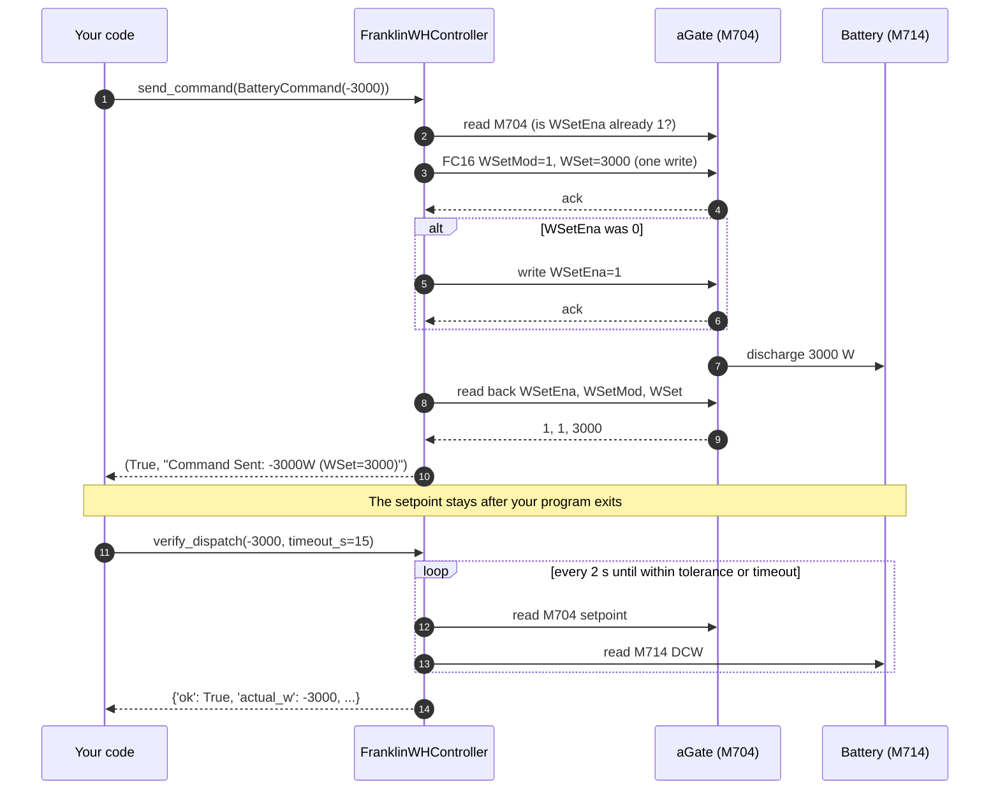
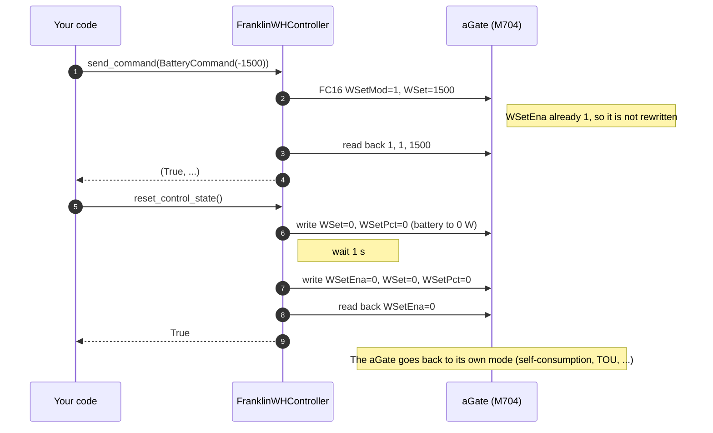

# FranklinWH Modbus TCP Implementation Guide

> **Definitive reference** for controlling FranklinWH aGate battery systems via Modbus TCP.
> Last verified: 2026-03-08 on aGate X (FW V10R01B04D00)

---

## 1. Connection

```
Host:    YOUR_AGATE_IP (default aGate IP)
Port:    502 (Modbus TCP)
Unit ID: 1 or 2 (both work, DA=1)
Base:    Address 1 (NOT standard 40000 for raw TCP)
Timeout: 10s recommended (WiFi can be slow)
```

```python
from franklinwh_modbus import FranklinWHController
ctrl = FranklinWHController('YOUR_AGATE_IP')
ctrl.connect()  # Scans SunSpec models, probes extension writability
```

**Models discovered:** 1, 502, 701, 702, 703, 704, 705, 706, 707, 708, 709, 710, 711, 712, 713, 714, 715

---

## 2. What You CAN and CANNOT Do

```
┌─────────────────────────────────────────────────────┐
│ ✅ CAN DO (SunSpec M704):     ❌ CANNOT DO:         │
│  • Charge battery at Xw        • Change mode        │
│  • Discharge battery at Xw     • Set reserve %      │
│  • Set idle (standby)          • Switch to Backup   │
│  • Toggle power factor (PF)    • Set max power cap  │
│  • Read ALL registers          • Control ramp rate  │
│  • Auto-revert (software)      • Use heartbeat      │
└─────────────────────────────────────────────────────┘
```

> Extension registers (15507-15509) are read-only. Writes to the FranklinWH extension registers are undocumented and unconfirmed. FranklinWH has not documented these registers and has never documented any of them as writable. Whether FranklinWH must authorise a Modbus client to write them, and how, is unknown. On `V12R02B60D00` (owner observation, 2026-10-21), writes to 15507–15509 did not take effect: the mode did not switch and the reserves did not change. Treat them as read-only.

---

## 3. Complete Writable Register Map

After exhaustive P1-P4 testing, only **5 of 48 M704 registers** accept writes:

| Register | Address | Type | Works? | What It Does |
|----------|---------|------|--------|---|
| `WSetEna` | 40318 | enum16 | ✅ | Enable/disable battery power control |
| `WSetMod` | 40319 | enum16 | ✅ | Power mode: 1 = watts (`WSet`), 0 = percent (`WSetPct`) |
| `WSetPct` | 40324 | int16 | ⚠️ | Percent setpoint; V12 refuses values over 10 % |
| `WSetRvrtTms` | 40327 | uint32 | ⚠️ | Accepts value, countdown never activates |
| `PFWInjEna` | 40298 | enum16 | ✅ | Power factor enable (on by default) |

**Everything else** — WMaxLimPct, VarSet, WRmp, ControllerHb, LocRemCtl — is either read-only (writes silently discarded) or unimplemented (returns `None`).

---

## 4. How to Control the Battery

### What happens on the wire

`send_command()` makes up to three Modbus requests and then checks the result.
The battery only moves once `WSetEna = 1`.



Changing power while running is one write, with no enable step (DER v1.2 §3.3).
Stopping writes `WSetEna = 0`:



> **Sign convention:** `BatteryCommand.power_watts` is positive = charge,
> negative = discharge, 0 = hold. The library converts it for the aGate.

### Power range

Power is in watts, from 0 to the battery's rating
(`ctrl.RATED_MAX_DISCHARGE_W`, read from the aGate at connect; 5000 W on one
battery). Anything above the rating is clamped to it. For a percentage, convert
it to watts (example 3).

### Python examples

Setup used by every example:

```python
from franklinwh_modbus import FranklinWHController
from franklinwh_modbus.types import BatteryCommand

ctrl = FranklinWHController('YOUR_AGATE_IP')
ctrl.connect()
```

**1. Discharge at 3000 W and confirm the battery moved**

```python
ok, msg = ctrl.send_command(BatteryCommand(power_watts=-3000))
if not ok:
    raise SystemExit(msg)          # refused, or read-back did not match

# A successful write is not proof: check battery power (it ramps for a few seconds)
result = ctrl.verify_dispatch(expected_w=-3000, timeout_s=15)
print(result['ok'], result['actual_w'], result['reason'])
```

**2. Minimum and maximum**

```python
ctrl.send_command(BatteryCommand(power_watts=-500))
ctrl.send_command(BatteryCommand(power_watts=-5000))   # maximum (M702 rating)
ctrl.send_command(BatteryCommand(power_watts=-8000))   # clamped to -5000, logs a warning
```

Use `ctrl.RATED_MAX_DISCHARGE_W` instead of a fixed 5000; it is read from M702
at connect.

**3. Percent of maximum**

`send_command()` takes watts. To work in percent, convert:

```python
pct = 40
watts = pct / 100 * ctrl.RATED_MAX_DISCHARGE_W          # 2000 W
ctrl.send_command(BatteryCommand(power_watts=-watts))
```


**4. Discharge for 30 minutes, then hand back to the aGate**

```python
ctrl.send_command(BatteryCommand(power_watts=-2000), duration_s=1800)
ctrl.get_command_timer_status()    # {'active': True, 'interval_s': 1800}
```

The timer runs in your process. If the process exits, the battery keeps
discharging: the aGate's own reversion timer does not work (§5.2). Keep the
process running, or stop it yourself.

**5. Change power while running**

```python
ctrl.send_command(BatteryCommand(power_watts=-1000))
ctrl.send_command(BatteryCommand(power_watts=-4000))   # one write, applies directly
```

**6. Hold the battery at 0 W (standby)**

```python
ctrl.send_command(BatteryCommand(power_watts=0))
```

Standby: the battery neither charges nor discharges; solar and grid supply the
house. Control stays with you. Release (example 7) hands control back, and the
aGate resumes its own mode, which may charge or discharge.

**7. Release control (hand back to the aGate)**

```python
ctrl.reset_control_state()          # True when WSetEna reads back 0
```

**8. Check the result**

```python
ok, msg = ctrl.send_command(BatteryCommand(power_watts=-2000))
if not ok:
    print(msg)   # the aGate refused it, or the read-back did not match
```

`send_command()` returns `(ok, msg)` and does not raise; always check `ok`.

### Check the aGate's state

Read this before a command (is the aGate already under control? what mode is it
in?) and after (did it take?). Mode and reserves come from FranklinWH
extension registers; see [Extension registers](FRANKLINWH_MODBUS_EXTENSIONS.md).

```python
bat  = ctrl.read_battery_status()    # M713/M714
mode = ctrl.read_native_mode()       # extension 15507–15509
ctl  = ctrl.read_control_status()    # M704
grid = ctrl.read_grid_status()       # M701

print("SoC            ", bat['soc'], "%")
print("Battery        ", bat['battery_power_w'], "W", bat['battery_state'])  # + = discharge; state from DCW, ±50 W
print("Operating mode ", mode['mode_name'])        # 15507: Emergency Backup / Self-Consumption / TOU
print("SC reserve     ", mode['self_reserve_pct'], "%")   # 15508
print("TOU reserve    ", mode['tou_reserve_pct'], "%")    # 15509
print("Grid           ", grid['connection_state'])
print("Under Modbus control:", ctl['wset_enabled'] == 1)
```

Notes:

- `battery_state` is derived from battery power. M713 `Sta` always reads 0 (§5.3).
- No extension register is documented as a run status. Don't treat any of
  15000–15043 as one.
- Extension registers are read-only in practice (§5.6). Don't write them to
  change mode or reserves.

### CLI

```bash
# Discharge at 3000 W (persists after the CLI exits)
python3 tools/franklinwh_cli.py -i YOUR_AGATE_IP --discharge 3000

# Discharge at 2000 W for 30 minutes (the CLI counts down, then stops; Ctrl+C stops early)
python3 tools/franklinwh_cli.py -i YOUR_AGATE_IP --discharge 2000 --revert 1800

# Maximum discharge (M702 rating)
python3 tools/franklinwh_cli.py -i YOUR_AGATE_IP --max-discharge

# Standby: hold at 0 W, control stays with you
python3 tools/franklinwh_cli.py -i YOUR_AGATE_IP --standby

# Check status (does not change the setpoint)
python3 tools/franklinwh_cli.py -i YOUR_AGATE_IP --status

# Release: hand control back to the aGate
python3 tools/franklinwh_cli.py -i YOUR_AGATE_IP --stop
```

---

## 5. Key Hardware Quirks

### 5.1 The LocRemCtl Paradox

M715 `LocRemCtl` (addr 1089) is **read-only, always "Local" (1)**. Per SunSpec 2, this should mean the DER rejects ALL writes. FranklinWH violates this — it **selectively** accepts power writes while ignoring lifecycle features:

| Feature | SunSpec 2 Expects | FranklinWH Does |
|---------|-------------------|-----------------|
| Power writes (WSetPct) | ❌ Reject | ✅ Accepts |
| Reversion countdown | N/A | ⚠️ Not verified with proper sequencing† |
| Controller heartbeat | ❌ Reject | ⚠️ Not verified with proper sequencing† |
| LocRemCtl write | Allow | ❌ Read-only |

**Impact:** All lifecycle features (heartbeat, reversion timer) currently implemented in **software**. †Re-verification with proper SunSpec 6-phase sequencing pending — see `SUNSPEC_DER_SEQUENCING_REFERENCE.md`.

### 5.2 Command Persistence

Commands **persist indefinitely** after disconnect. The aGate holds the last WSetPct value until:
- Another `send_command()` overwrites it
- `reset_control_state()` sets WSetEna=0
- The aGate is power-cycled

There is **no automatic timeout** — hardware reversion (`WSetRvrtTms`) accepts values but never executes. Use the library's software timer (`duration_s` parameter).

### 5.3 Battery State Is Not in M713

M713 `Sta` is a status flag (SunSpec 2: 0 OK, 1 WARNING, 2 ERROR), not a charge/discharge state; it read 0 (OK) while charging. Derive battery state from M714 `DCW` (positive = discharging on V12, c8):

```python
if dc_power < -50:   state = 'CHARGING'
elif dc_power > 50:  state = 'DISCHARGING'
else:                state = 'IDLE'
```

### 5.4 Sign Convention

| Register | Software | Hardware |
|----------|----------|----------|
| `WSet` | Positive = Charge | **Negative = Charge** (V12, c3/c8) |
| `WSetPct` | Positive = Charge | **Negative = Charge** |

The library inverts: `m704.WSet.value = -watts`

### 5.5 WSet vs WSetPct

An earlier note said writing `WSet` alongside `WSetPct` caused "mode flickering". It came from one user report (2026-02) with no firmware, frames or `WSetMod=1` test, and is unverified. With `WSetMod=1`, `WSet` works on V12 (c3, c8). The library now sends watts through `WSet`.

### 5.6 Extension Registers: Writes Undocumented

| Address | Name | Access | Notes |
|---------|------|--------|-------|
| 15507 | OnGridMode | R (writes undocumented) | 1=Backup, 2=Self-Consumption, 3=TOU |
| 15508 | SelfReserve | R (writes undocumented) | Reserve SOC % |
| 15509 | TouReserve | R (writes undocumented) | ⚠️ **Always mirrors 15508** (firmware defect) |

Writes to the FranklinWH extension registers are undocumented and unconfirmed. FranklinWH has not documented these registers and has never documented any of them as writable. Whether FranklinWH must authorise a Modbus client to write them, and how, is unknown. On `V12R02B60D00` (owner observation, 2026-10-21), writes to 15507–15509 did not take effect: the mode did not switch and the reserves did not change. Treat them as read-only.

The library's setters (`set_native_mode()`, `set_self_consumption_reserve()`, `set_tou_reserve()`) attempt the write, read the register back, and return `(ok, message)` with the read-back result. They do not promise any effect.

Earlier versions of this guide said that writes need a "SPAN Modbus" unlock that FranklinWH enables for SPAN Smart Panel owners, and that a SPAN panel on the network or a cloud `spanFlag` setting predicts writability. That was **speculation (undocumented, unverified)** and has been removed. SPAN is a third-party smart-panel company; nothing here implies any relationship between SPAN and FranklinWH or this library.

#### Checking your unit

`--test-extension-write` (or `ctrl.test_extension_writability()`) writes test values to 15507–15509, reads them back and restores them. ⚠️ It writes to the device. The read-back is the only reliable answer.

#### Mode Control Tiers (Web App)

The admin console defines three control tiers. Tier 1 assumes extension writes work, which is **speculation (undocumented, unverified)**:

| Tier | Method | Capability |
|------|--------|------------|
| ⚡ Tier 1: Extension writes | Direct Modbus register writes (undocumented; not applied on V12R02B60D00) | Full mode/reserve control (Phase 4) |
| ☁️ Tier 2: Cloud Bypass | Mode changes via Cloud API | Mode control, data stays Modbus |
| 📖 Tier 3: Read-Only | View only | No control |

> **TODO:** Mode Control Tier selection should move from MQTT Admin to a **Setup Wizard** — it's a one-time configuration decision, not an MQTT setting.

### 5.7 PFWInjEna (Power Factor)

`PFWInjEna` (40298) is **enabled by default (=1)** and **writable**:
- Enabled (=1): PF ≈ unity (-1 raw, SF -3)
- Disabled (=0): PF = 0.003 (essentially no correction)
- **Do not leave disabled** — it controls the aGate's default PF correction

### 5.8 SunSpec2 Library Quirks

The `sunspec2` Python client remaps addresses internally. Extension registers (15000+, 15500+) must be read via **raw Modbus TCP socket**, not `sunspec2.client.read()`:

```python
import struct
sock = ctrl.dev.client.socket
req = struct.pack('>HHHBBHH', 0, 0, 6, unit_id, 3, addr, count)
sock.sendall(req)
resp = sock.recv(256)
```

### 5.9 M715 Address Space

M715 registers are read and written at their **PDU addresses** (1087–1095, as in the FranklinWH PICS). Offsetting by 40000 (PDU 41087+) returned exception 2 (`ILLEGAL_DATA_ADDRESS`) on V10R01B04D00; V12R02B60D00 mirrors the map at 40000. Use the PDU address. The aGate's SunSpec map starts at PDU 0; see QUIRKS, Register Addressing.

---

## 6. Software vs Hardware Features

| Feature | Hardware | Software (Library) |
|---------|----------|-------------------|
| Charge/Discharge | ✅ M704 WSetPct | ✅ `send_command()` |
| Auto-Revert Timer | ❌ WSetRvrtTms broken | ✅ `duration_s` param |
| Heartbeat | ❌ ControllerHb ignored | ❌ Not implemented |
| SoC Ramp | ❌ WRmp unimplemented | ✅ `--soc-ramp-window` |
| Battery State | ❌ Not in M713 (Sta is OK/WARNING/ERROR) | ✅ Derived from M714 DCW |
| Conflict Detection | N/A | ✅ `check_state()` |
| Mode Control | ❌ Extensions read-only | ⚠️ Virtual modes (power-only) |

---

## 7. Reading System State

```python
# Battery
bat = ctrl.read_battery_status()
# → soc, dc_power, dc_voltage, temperature, battery_state

# Solar + Grid + Load
solar = ctrl.read_solar_production()
grid  = ctrl.read_grid_status()

# Control status
ctl = ctrl.read_control_status()
# → wset_enabled, wset_pct, wset_watts

# Native mode (aGate's cloud setting)
mode = ctrl.read_native_mode()
# → mode_name, self_reserve_pct, tou_reserve_pct

# Health check (zombie state detection)
h = ctrl.healthcheck()
# → healthy, message, recommendations
```

---

## 8. Related Documentation

| Document | What It Covers |
|----------|---------------|
| [DER_CONTROL_REFERENCE.md](./DER_CONTROL_REFERENCE.md) | Full register map — all 48 M704 + 6 M715 fields |
| [FRANKLINWH_SUNSPEC_QUIRKS.md](./FRANKLINWH_SUNSPEC_QUIRKS.md) | Detailed quirk analysis (LocRemCtl, M713, extensions) |
| [ORCHESTRATION_AND_CONTROL.md](./ORCHESTRATION_AND_CONTROL.md) | Command sequences, SoC ramping, entry points |
| `VERIFICATION_BASELINE.md` | Full register dump + cross-verification |

### Test Evidence

| Test | Result | Evidence |
|------|--------|----------|
| P1: Heartbeat | ❌ Confirmed non-functional (6-phase re-test) | `tests/results/2026-03-08_p1_control_tests.md` |
| P1: WSetRvrtTms | ✅ **WORKS** (60s accepted, countdown active) | Re-tested 2026-03-13 with proper sequencing |
| P2: WMaxLimPct | ❌ Confirmed non-functional (enable silently discarded) | `tests/results/2026-03-08_p2p4_control_tests.md` |
| P3: VarSet | ❌ Confirmed non-functional (VarSetEna silently discarded) | Re-tested 2026-03-13 with 6-phase protocol |
| PCS WChaRteMax/WDisChaRteMax | ❌ Confirmed 0xFFFF (not writable) | `tests/results/2026-03-13_pcs_charge_rate_write_probe.md` |
| P4: WRmp | ❌ Unimplemented | Same file |
| PFWInjEna | ✅ Writable | Same file |
| Extension write-probe | ❌ Read-only | `tests/results/2026-03-08_extension_write_probe.md` |

---

*Device: FranklinWH aGate X (SN: XXXXXXXXXXXXXXXXXXXX, FW: V10R01B04D00)*
*Last Updated: 2026-03-09*
