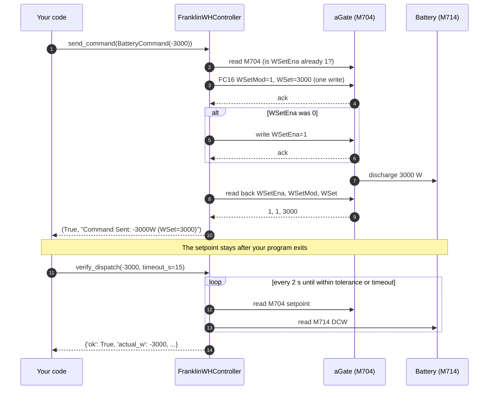
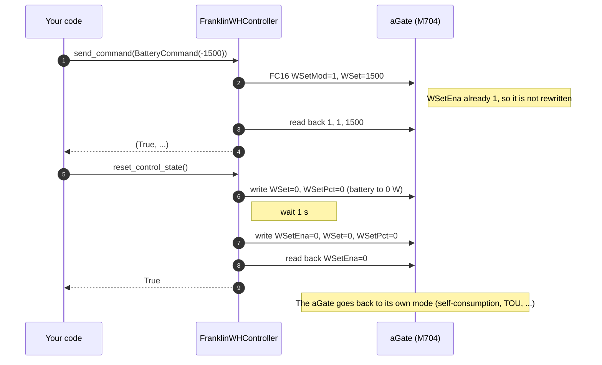

# FranklinWH Modbus TCP Implementation Guide

> How to read and control a FranklinWH aGate over Modbus TCP with this library.
> Last checked: 2026-10-24 against aGate firmware V12R02B60D00. Rows marked
> **V10** were measured on V10R01B04D00 and not re-tested on V12.

---

## 1. Connection

```
Host:    YOUR_AGATE_IP
Port:    502 (Modbus TCP)
Unit ID: 1
Address: SunSpec map starts at PDU address 0 ("SunS" at 0-1).
         V12R02B60D00 also answers at +40000; V10R01B04D00 did not.
Timeout: 10 s recommended (Wi-Fi can be slow)
```

```python
from franklinwh_modbus import FranklinWHController
ctrl = FranklinWHController('YOUR_AGATE_IP', unit_id=1)
ctrl.connect()  # scans the SunSpec models and reads the ratings; never writes
```

**Models on V12R02B60D00:** 1, 701, 702, 703, 704, 705, 706, 707, 708, 709, 710, 711, 712, 713, 714, 715, 502

Use one Modbus client per aGate at a time.

---

## 2. What You Can and Cannot Do

| ✅ Can | ❌ Cannot |
|---|---|
| Discharge the battery, up to the M702 rating (5000 W on V12R02B60D00) | Charge the battery (refused on V12R02B60D00) |
| Hold the battery at 0 W (standby) | Change the operating mode |
| Release control back to the aGate | Change the SoC reserves |
| Read SoC, power, mode, reserves, grid, solar, alarms | Set a maximum power cap (`WMaxLimPct`, **V10**) |
| Auto-release after a time (library timer) | Use the aGate's heartbeat or reversion as a fail-safe |
| Toggle power-factor correction (`PFWInjEna`, **V10**) | |

---

## 3. Writable Registers (M704)

Addresses are PDU addresses (base 0).

| Register | PDU | Type | Result | What it does |
|---|---|---|---|---|
| `WSetEna` | 318 | enum16 | ✅ | Enable / disable power control |
| `WSetMod` | 319 | enum16 | ✅ | 1 = watts (`WSet`), 0 = percent (`WSetPct`) |
| `WSet` | 320–321 | int32 | ✅ | Power setpoint in W; the library uses this |
| `WSetPct` | 324 | int16 | ⚠️ | Percent setpoint; 10 % (500 W) is the most accepted |
| `WSetRvrtTms` | 327–328 | uint32 | ⚠️ | Accepted, but reversion works backwards (§5.2) |
| `PFWInjEna` | 298 | enum16 | ✅ **V10** | Power-factor correction, 1 = enabled (default) |

`WMaxLimPct`, `VarSet`, `WRmp` and `LocRemCtl` (**V10**) and `ControllerHb`
(V12R02B60D00) do not take writes.

---

## 4. How to Control the Battery

### What happens on the wire

`send_command()` makes up to three Modbus requests and then checks the result.
The battery only moves once `WSetEna = 1`.



Changing power while running is one write, with no enable step (DER v1.2 §3.3).
Stopping writes `WSetEna = 0`:



> **Sign convention:** `BatteryCommand.power_watts` is positive = charge,
> negative = discharge, 0 = hold. The library converts it for the aGate.

### Power range

Power is in watts, from 0 to the battery's rating
(`ctrl.RATED_MAX_DISCHARGE_W`, read from the aGate at connect; 5000 W on one
battery). Anything above the rating is clamped to it. For a percentage, convert
it to watts (example 3).

### Python examples

Setup used by every example:

```python
from franklinwh_modbus import FranklinWHController
from franklinwh_modbus.types import BatteryCommand

ctrl = FranklinWHController('YOUR_AGATE_IP')
ctrl.connect()
```

**1. Discharge at 3000 W and confirm the battery moved**

```python
ok, msg = ctrl.send_command(BatteryCommand(power_watts=-3000))
if not ok:
    raise SystemExit(msg)          # refused, or read-back did not match

# A successful write is not proof: check battery power (it ramps for a few seconds)
result = ctrl.verify_dispatch(expected_w=-3000, timeout_s=15)
print(result['ok'], result['actual_w'], result['reason'])
```

**2. Minimum and maximum**

```python
ctrl.send_command(BatteryCommand(power_watts=-500))
ctrl.send_command(BatteryCommand(power_watts=-5000))   # maximum (M702 rating)
ctrl.send_command(BatteryCommand(power_watts=-8000))   # clamped to -5000, logs a warning
```

Use `ctrl.RATED_MAX_DISCHARGE_W` instead of a fixed 5000; it is read from M702
at connect.

**3. Percent of maximum**

`send_command()` takes watts. To work in percent, convert:

```python
pct = 40
watts = pct / 100 * ctrl.RATED_MAX_DISCHARGE_W          # 2000 W
ctrl.send_command(BatteryCommand(power_watts=-watts))
```


**4. Discharge for 30 minutes, then hand back to the aGate**

```python
ctrl.send_command(BatteryCommand(power_watts=-2000), duration_s=1800)
ctrl.get_command_timer_status()    # {'active': True, 'interval_s': 1800}
```

The timer runs in your process. If the process exits, the battery keeps
discharging: the aGate's own reversion timer does not work (§5.2). Keep the
process running, or stop it yourself.

**5. Change power while running**

```python
ctrl.send_command(BatteryCommand(power_watts=-1000))
ctrl.send_command(BatteryCommand(power_watts=-4000))   # one write, applies directly
```

**6. Hold the battery at 0 W (standby)**

```python
ctrl.send_command(BatteryCommand(power_watts=0))
```

Standby: the battery neither charges nor discharges; solar and grid supply the
house. Control stays with you. Release (example 7) hands control back, and the
aGate resumes its own mode, which may charge or discharge.

**7. Release control (hand back to the aGate)**

```python
ctrl.reset_control_state()          # True when WSetEna reads back 0
```

**8. Check the result**

```python
ok, msg = ctrl.send_command(BatteryCommand(power_watts=-2000))
if not ok:
    print(msg)   # the aGate refused it, or the read-back did not match
```

`send_command()` returns `(ok, msg)` and does not raise; always check `ok`.

### Check the aGate's state

Read this before a command (is the aGate already under control? what mode is it
in?) and after (did it take?). Mode and reserves come from FranklinWH
extension registers; see [Extension registers](FRANKLINWH_MODBUS_EXTENSIONS.md).

```python
bat  = ctrl.read_battery_status()    # M713/M714
mode = ctrl.read_native_mode()       # extension 15507–15509
ctl  = ctrl.read_control_status()    # M704
grid = ctrl.read_grid_status()       # M701

print("SoC            ", bat['soc'], "%")
print("Battery        ", bat['battery_power_w'], "W", bat['battery_state'])  # + = discharge; state from DCW, ±50 W
print("Operating mode ", mode['mode_name'])        # 15507: Emergency Backup / Self-Consumption / TOU
print("SC reserve     ", mode['self_reserve_pct'], "%")   # 15508
print("TOU reserve    ", mode['tou_reserve_pct'], "%")    # 15509
print("Grid           ", grid['connection_state'])
print("Under Modbus control:", ctl['wset_enabled'] == 1)
```

Notes:

- `battery_state` is derived from battery power. M713 `Sta` always reads 0 (§5.3).
- No extension register is documented as a run status. Don't treat any of
  15000–15043 as one.
- Extension registers are read-only in practice (§5.6). Don't write them to
  change mode or reserves.

### CLI

```bash
# Discharge at 3000 W (persists after the CLI exits)
python3 tools/franklinwh_cli.py -i YOUR_AGATE_IP --discharge 3000

# Discharge at 2000 W for 30 minutes (the CLI counts down, then stops; Ctrl+C stops early)
python3 tools/franklinwh_cli.py -i YOUR_AGATE_IP --discharge 2000 --revert 1800

# Maximum discharge (M702 rating)
python3 tools/franklinwh_cli.py -i YOUR_AGATE_IP --max-discharge

# Standby: hold at 0 W, control stays with you
python3 tools/franklinwh_cli.py -i YOUR_AGATE_IP --standby

# Check status (does not change the setpoint)
python3 tools/franklinwh_cli.py -i YOUR_AGATE_IP --status

# Release: hand control back to the aGate
python3 tools/franklinwh_cli.py -i YOUR_AGATE_IP --stop
```

---

## 5. Hardware Behaviour

### 5.1 LocRemCtl

M715 `LocRemCtl` (PDU 1089) is read-only and reads 1 (Local). SunSpec says a
DER in Local should refuse remote writes; the aGate accepts M704 power writes
anyway.

### 5.2 Commands Persist; Reversion and Heartbeat Do Not Help

The setpoint stays after your program disconnects, until another command,
`reset_control_state()`, or a power cycle.

- **Reversion** (`WSetRvrtTms`) works backwards on V12R02B60D00: the reversion
  value applies *during* the countdown and your setpoint *after* it.
- **Heartbeat** (`ControllerHb`) writes are acknowledged but read back 0 on
  V12R02B60D00.

Use the library's timer (`duration_s`) or your own watchdog to release control.

### 5.3 Battery Status and Battery State

M713 `Sta` is a health status: 0 = OK, 1 = WARNING, 2 = ERROR (SunSpec
`model_713.json`). It reads 0 (OK) on V12R02B60D00. `read_alarms()` reports it
as `battery_sta`.

M713 has no charging/discharging point. `read_battery_status()` derives
`battery_state` from M714 `DCW` (positive = discharge):

```python
if dc_power > 50:    state = 'Discharging'
elif dc_power < -50: state = 'Charging'
else:                state = 'Idle'
```

### 5.4 Sign Convention

| | Charge | Discharge |
|---|---|---|
| `BatteryCommand.power_watts` | positive | negative |
| aGate `WSet`, `WSetPct` | negative | positive |
| M714 `DCW` | negative | positive |

The library converts.

### 5.5 Extension Registers Are Read-Only

| PDU | Name | Meaning |
|---|---|---|
| 15507 | OnGridMode | 1 = Emergency Backup, 2 = Self-Consumption, 3 = TOU |
| 15508 | SelfReserve | Self-consumption SoC reserve, % |
| 15509 | TouReserve | TOU SoC reserve, % |
| 16001 | — | Reserve for the active mode, % (undocumented) |

Writes to 15507–15509 are acknowledged but do not take effect on
V12R02B60D00. FranklinWH has not documented these registers as writable. Read
them with `read_native_mode()`; all of them are listed in
[Extension registers](FRANKLINWH_MODBUS_EXTENSIONS.md).

Extension registers are outside the SunSpec model chain, so `sunspec2` cannot
read them; the library reads them with raw FC3 requests.

### 5.6 PFWInjEna (Power Factor) — **V10**

`PFWInjEna` (PDU 298) reads 1 (enabled) by default, on V10 and V12. On
V10R01B04D00, writing 0 dropped the power factor to 0.003. Leave it enabled.

---

## 6. Library vs Hardware

| Feature | aGate | Library |
|---|---|---|
| Discharge | ✅ M704 `WSet` | ✅ `send_command()` |
| Charge | ❌ refused on V12R02B60D00 | — |
| Auto-release timer | ❌ reversion works backwards | ✅ `duration_s` |
| Heartbeat | ❌ not functional | ❌ not implemented |
| SoC ramp near limits | ❌ `WRmp` unimplemented (**V10**) | ✅ `--soc-ramp-window` (virtual modes) |
| Battery state | — no M713 point | ✅ from M714 `DCW` |
| Conflict detection | — | ✅ `check_state()` |
| Mode / reserve control | ❌ extensions read-only | ⚠️ virtual modes (power only) |
| Health check | — | ✅ `healthcheck()` |

---

## 7. Related Documentation

| Document | What it covers |
|---|---|
| [M704 conformance results (V12)](SUNSPEC_M704_V12_CONFORMANCE_RESULTS.md) | V12 dispatch, charge, reversion tests |
| [FRANKLINWH_SUNSPEC_QUIRKS.md](FRANKLINWH_SUNSPEC_QUIRKS.md) | Every known quirk, with evidence |
| [Extension registers](FRANKLINWH_MODBUS_EXTENSIONS.md) | 15000–16002 |
| [DER_CONTROL_REFERENCE.md](DER_CONTROL_REFERENCE.md) | All M704 and M715 points |
| [ORCHESTRATION_AND_CONTROL.md](ORCHESTRATION_AND_CONTROL.md) | Command sequences, SoC ramping |
| [API_COOKBOOK.md](API_COOKBOOK.md) | Every read method and its keys |
