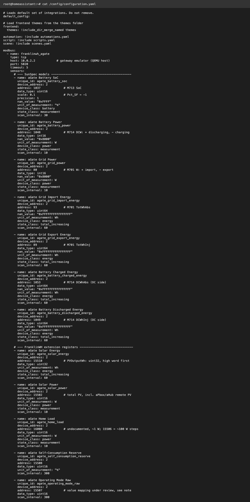
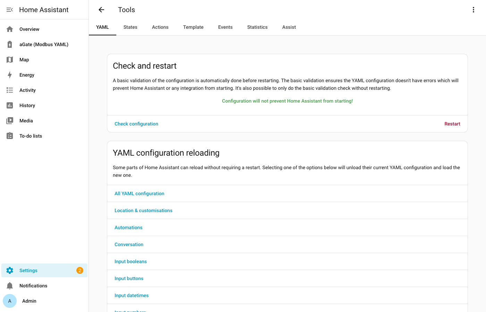
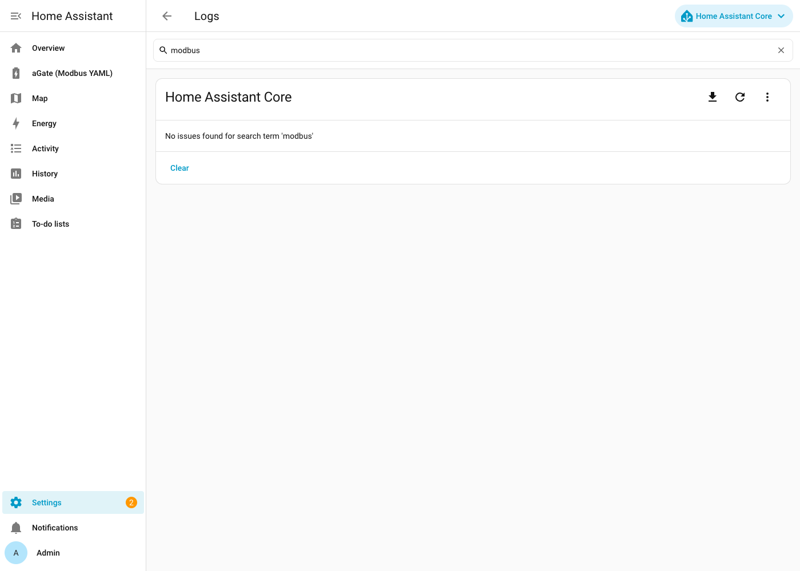
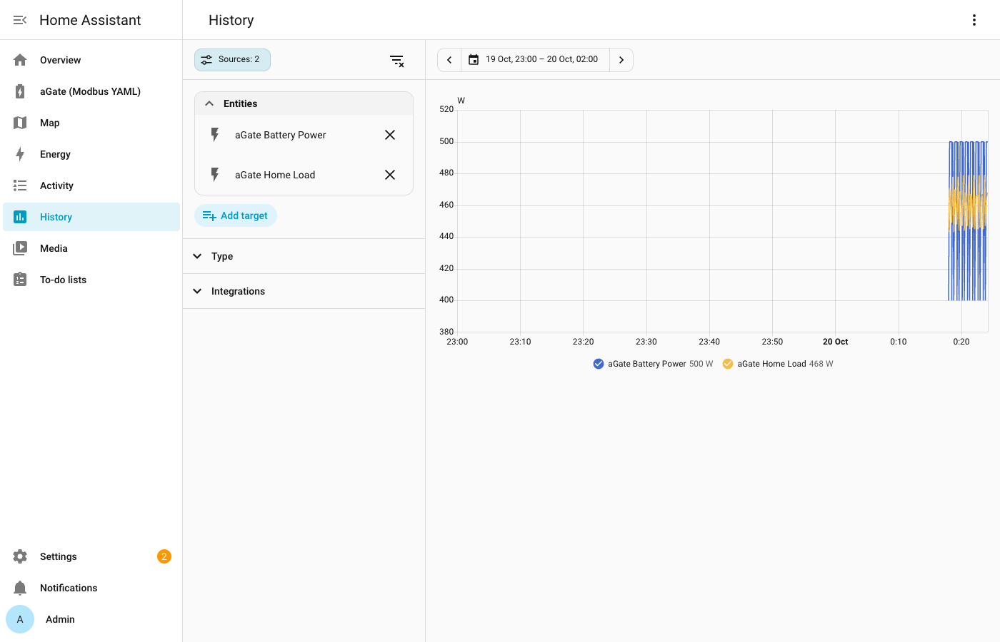
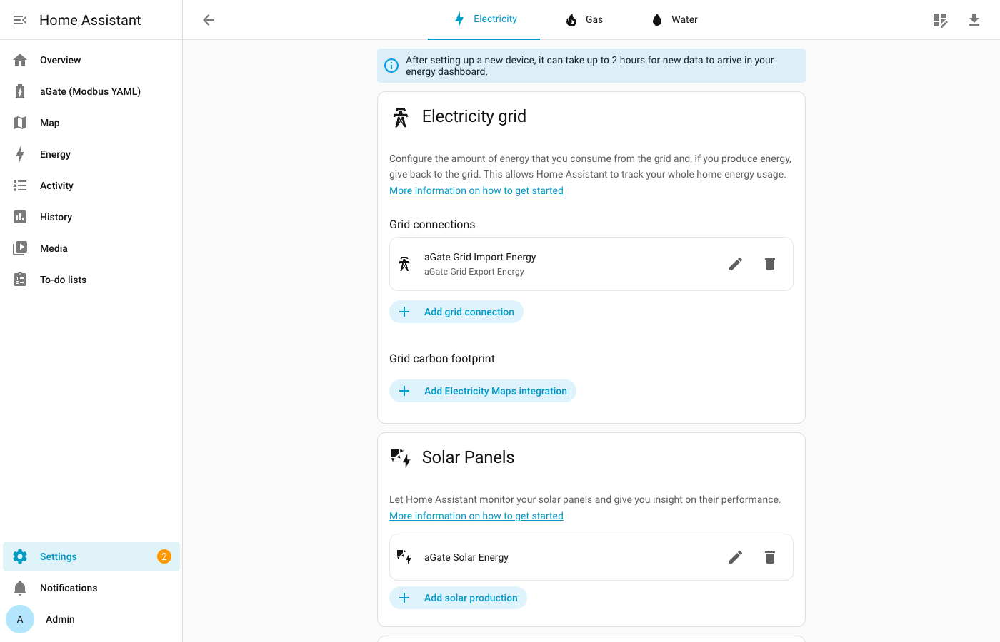
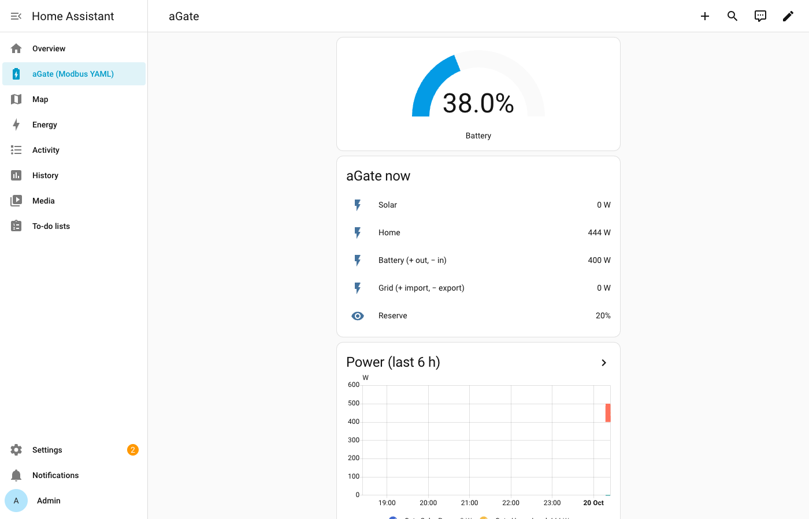

# Home Assistant: Monitoring with Modbus YAML

A minimal, **monitor-only** way to see your aGate's core metrics in Home Assistant, using HA's built-in [Modbus integration](https://www.home-assistant.io/integrations/modbus/) and a block of YAML. No add-on, no Python, no FranklinWH library.

!!! warning "Read before you start"
    - **Monitor only.** This guide reads registers and never writes. Don't add `modbus.write_register` automations against the aGate: there's no clamp, no release and no verification here. For battery control, use a FranklinWH integration built on this library.
    - **One Modbus client per aGate: stop or uninstall the others first.** Home Assistant's Modbus integration keeps its own TCP connection open to the aGate. Before adding this YAML, **stop or uninstall** any FranklinWH bridge add-on or integration, and anything else that talks to port 502: this library's CLI or TUI, or a tool that probes :502. Two clients cause dropped connections and "unavailable" sensors.
    - **Scale factors are fixed in the YAML.** SunSpec keeps scale factors in separate registers; the values below were read on firmware V10R01B04D00 on 2026-05-14. Check yours (step 1), and again after a firmware update.
    - **Tested against the gateway emulator, not yet against a real aGate.** On 2026-10-20 the guide's first 12 sensors and the dashboard card worked in Home Assistant 2026.10.1 (HAOS VM) against the FranklinWH Gateway Emulator 0.1.0. The emulator proves the YAML works; its numbers aren't device values. Compare HA's values with the CLI (step 4) before relying on them.

---

## What you get

| Sensor | Register (PDU) | Source |
|---|---|---|
| Battery SoC (%) | 1037 | SunSpec M713 `SoC` |
| Battery power (W; + discharging, − charging) | 1048 | SunSpec M714 `DCW` |
| Grid power (W; + import, − export) | 80 | SunSpec M701 `W` |
| Solar power (W) | 15502 | FranklinWH extension |
| Home load (W) | 16000 | FranklinWH extension (undocumented, ~1 W resolution) |
| Self-consumption reserve (%) | 15508 | FranklinWH extension |
| Operating mode (raw number) | 15507 | FranklinWH extension |
| Grid import / export energy (Wh, lifetime) | 93 / 89 | SunSpec M701 `TotWhAbs` / `TotWhInj` |
| Solar energy (Wh, lifetime) | 15510–15511 | FranklinWH extension, uint32, high word first |
| Grid connection state (raw) | 75 | SunSpec M701 `ConnSt`: 0 = DISCONNECTED, 1 = CONNECTED |
| Inverter state (raw) | 74 | SunSpec M701 `InvSt`: 0 OFF … 3 RUNNING … 6 FAULT, 7 STANDBY |
| DER mode bits (raw) | 78–79 | SunSpec M701 `DERMode`: bit 0 GRID_FOLLOWING, bit 1 GRID_FORMING (off-grid), bit 2 PV_CLIPPED |
| Alarm bits (raw) | 76–77 | SunSpec M701 `Alrm`: bit 4 GRID_DISCONNECT and others |
| **Grid status** (derived) | — | Template: On grid / Backup (off-grid) / Grid disconnected |
| **Grid connected** (derived) | — | Template binary sensor |
| Battery charged / discharged energy (Wh, lifetime) | 1053 / 1049 | SunSpec M714 `DCWhAbs` / `DCWhInj` |

Addresses are Modbus **PDU addresses**. Home Assistant also counts from 0, so they go into `address:` exactly as listed. Never add 40000 or 40001: the aGate answers those with exception 2. See [Register Addressing](FRANKLINWH_SUNSPEC_QUIRKS.md#register-addressing-pdu-addresses-modbus-and-the-sunspec-map).

---

## 1. Before you start

- **Modbus TCP enabled.** Your installer has to turn Modbus TCP on for the aGate; the FranklinWH app can't.
- **The aGate's IP address,** reachable from Home Assistant. Give it a fixed address (DHCP reservation).
- **Your scale factors (recommended).** With this library installed on any computer, and with no other Modbus client running, run:

  ```bash
  python3 tools/modbus_sunspec2_reader.py -i <AGATE_IP> -b 1 -dvalues --vals
  ```

  Check these against the values the YAML assumes:

  | Point | PDU | Value the YAML assumes |
  |---|---|---|
  | M713 `Pct_SF` | 1041 | −1 (SoC raw 500 = 50.0 %) |
  | M714 `DCW_SF` | 1059 | 0 |
  | M714 `DCWH_SF` | 1060 | 0 |
  | M701 `W_SF` | 186 | 0 |
  | M701 `TotWh_SF` | 190 | 0 |

  Also check the model IDs sit where the YAML expects: M701 at 70, M713 at 1033, M714 at 1042. If any differ, your firmware lays the map out differently; don't use this YAML unchanged.

---

## 2. The YAML

Add this to `configuration.yaml`, or to a file you include from it. Replace `192.0.2.10` with your aGate's IP.

{ width="420" }

```yaml
modbus:
  - name: franklinwh_agate
    type: tcp
    host: 192.0.2.10          # your aGate
    port: 502
    timeout: 5
    sensors:
      # --- SunSpec models ---------------------------------------------
      - name: aGate Battery SoC
        unique_id: agate_battery_soc
        device_address: 2
        address: 1037             # M713 SoC
        data_type: uint16
        scale: 0.1                # Pct_SF = -1
        precision: 1
        nan_value: "0xFFFF"
        unit_of_measurement: "%"
        device_class: battery
        state_class: measurement
        scan_interval: 30

      - name: aGate Battery Power
        unique_id: agate_battery_power
        device_address: 2
        address: 1048             # M714 DCW: + discharging, - charging
        data_type: int16
        nan_value: "0x8000"
        unit_of_measurement: W
        device_class: power
        state_class: measurement
        scan_interval: 10

      - name: aGate Grid Power
        unique_id: agate_grid_power
        device_address: 2
        address: 80               # M701 W: + import, - export
        data_type: int16
        nan_value: "0x8000"
        unit_of_measurement: W
        device_class: power
        state_class: measurement
        scan_interval: 10

      - name: aGate Grid Import Energy
        unique_id: agate_grid_import_energy
        device_address: 2
        address: 93               # M701 TotWhAbs
        data_type: uint64
        nan_value: "0xFFFFFFFFFFFFFFFF"
        unit_of_measurement: Wh
        device_class: energy
        state_class: total_increasing
        scan_interval: 60

      - name: aGate Grid Export Energy
        unique_id: agate_grid_export_energy
        device_address: 2
        address: 89               # M701 TotWhInj
        data_type: uint64
        nan_value: "0xFFFFFFFFFFFFFFFF"
        unit_of_measurement: Wh
        device_class: energy
        state_class: total_increasing
        scan_interval: 60

      - name: aGate Battery Charged Energy
        unique_id: agate_battery_charged_energy
        device_address: 2
        address: 1053             # M714 DCWhAbs (DC side)
        data_type: uint64
        nan_value: "0xFFFFFFFFFFFFFFFF"
        unit_of_measurement: Wh
        device_class: energy
        state_class: total_increasing
        scan_interval: 60

      - name: aGate Battery Discharged Energy
        unique_id: agate_battery_discharged_energy
        device_address: 2
        address: 1049             # M714 DCWhInj (DC side)
        data_type: uint64
        nan_value: "0xFFFFFFFFFFFFFFFF"
        unit_of_measurement: Wh
        device_class: energy
        state_class: total_increasing
        scan_interval: 60

      # --- FranklinWH extension registers ------------------------------
      - name: aGate Solar Energy
        unique_id: agate_solar_energy
        device_address: 2
        address: 15510            # PVOutputWh: uint32, high word first
        data_type: uint32
        unit_of_measurement: Wh
        device_class: energy
        state_class: total_increasing
        scan_interval: 60

      - name: aGate Solar Power
        unique_id: agate_solar_power
        device_address: 2
        address: 15502            # total PV, incl. aPbox/aHub remote PV
        data_type: uint16
        unit_of_measurement: W
        device_class: power
        state_class: measurement
        scan_interval: 10

      - name: aGate Home Load
        unique_id: agate_home_load
        device_address: 2
        address: 16000            # undocumented, ~1 W; 15506 = ~100 W steps
        data_type: uint16
        unit_of_measurement: W
        device_class: power
        state_class: measurement
        scan_interval: 10

      - name: aGate Self-Consumption Reserve
        unique_id: agate_self_consumption_reserve
        device_address: 2
        address: 15508
        data_type: uint16
        unit_of_measurement: "%"
        scan_interval: 300

      - name: aGate Operating Mode Raw
        unique_id: agate_operating_mode_raw
        device_address: 2
        address: 15507            # value mapping under review, see note
        data_type: uint16
        scan_interval: 300

      # --- Grid connection status (SunSpec M701) ------------------------
      - name: aGate Grid Connection Raw
        unique_id: agate_grid_connection_raw
        device_address: 2
        address: 75               # M701 ConnSt: 0 DISCONNECTED, 1 CONNECTED
        data_type: uint16
        nan_value: "0xFFFF"
        scan_interval: 10

      - name: aGate Inverter State Raw
        unique_id: agate_inverter_state_raw
        device_address: 2
        address: 74               # M701 InvSt
        data_type: uint16
        nan_value: "0xFFFF"
        scan_interval: 30

      - name: aGate DER Mode Raw
        unique_id: agate_der_mode_raw
        device_address: 2
        address: 78               # M701 DERMode bitfield32: bit 1 = GRID_FORMING
        data_type: uint32
        nan_value: "0xFFFFFFFF"
        scan_interval: 10

      - name: aGate Alarm Bits Raw
        unique_id: agate_alarm_bits_raw
        device_address: 2
        address: 76               # M701 Alrm bitfield32: bit 4 = GRID_DISCONNECT
        data_type: uint32
        nan_value: "0xFFFFFFFF"
        scan_interval: 30

# Readable grid status, derived from the raw sensors above
template:
  - sensor:
      - name: aGate Grid Status
        unique_id: agate_grid_status
        state: >
          
          
          Backup (off-grid)
          On grid
          Grid disconnected
          Unknown
  - binary_sensor:
      - name: aGate Grid Connected
        unique_id: agate_grid_connected
        device_class: connectivity
        state: >
          {{ states('sensor.agate_grid_connection_raw') | int(-1) == 1
             and not (states('sensor.agate_der_mode_raw') | int(0) | bitwise_and(2)) }}
```

**Notes:**
- **Unit ID.** `device_address: 2` is the FranklinWH default. The aGate answers on any unit ID ([QUIRKS](FRANKLINWH_SUNSPEC_QUIRKS.md)).
- **Scan intervals.** About 10 s for power and longer for energy and settings keeps traffic modest: 16 Modbus sensors means 16 requests per cycle. HA's default is 15 s. Polling faster than about 5 s hasn't been tested against an aGate.
- **Reconnects.** HA's Modbus client reconnects by itself. How it behaves when the aGate drops the session hasn't been measured.
- **TOU reserve isn't included.** 15509 reads the same value as 15508 on current firmware, so it isn't the TOU reserve (#63).
- **Operating mode is shown as a raw number.** Which number means which mode is still being confirmed (#75). The library and a 2026-05 device scan say 1 = Emergency Backup, 2 = Self-Consumption, 3 = TOU, but treat that as provisional.
- **Grid status: what it can and can't tell you.** "Backup (off-grid)" comes from M701 `DERMode` bit 1 (GRID_FORMING: the aPower is making its own AC). "Grid disconnected" comes from `ConnSt` = 0. Neither has been observed during a real outage on an aGate yet; all readings so far were on-grid. Modbus also can't tell a real utility outage from a deliberate off-grid switch, which the FranklinWH cloud API can ([Modbus vs Cloud](MODBUS_CLOUD_COMPARISON.md)). The "Emergency Backup" operating mode (15507) is a setting that keeps the battery in reserve; it doesn't mean the grid is down.
- **Battery power is the DC side** (M714). With more than one aPower, PDU 1048 is the model's top-level total. That hasn't been verified on a multi-battery site.

---

## 3. Restart and check

Check the configuration first (**Developer tools → YAML → Check configuration**), then restart Home Assistant (**Settings → System → Restart**).

{ width="600" }

 Then open **Settings → Devices & services → Entities** and search for `aGate`. All 16 Modbus sensors and the 2 template sensors should have values within a minute.

| Symptom | Likely cause |
|---|---|
| All sensors **unavailable** | Another Modbus client is connected, Modbus TCP isn't enabled, or the IP is wrong |
| One sensor unavailable, log shows exception 2 | Wrong address (e.g. offset by 40000), or the register doesn't exist on your firmware |
| SoC shows 500 instead of 50 | `scale: 0.1` missing |
| Values look plausible but differ from the app | Scale factor or address differs on your firmware: redo step 1 |

A clean run shows no Modbus errors in **Settings → System → Logs** (search "modbus"):

{ width="600" }

Sensor history (**History**, add the aGate sensors):

{ width="600" }

---

## 4. Verify against the CLI

Stop Home Assistant's Modbus hub first (one client at a time): comment out the YAML and restart, or stop HA. Then run:

```bash
python3 tools/franklinwh_cli.py -i <AGATE_IP> --status --detail
```

Compare SoC, battery power, grid power, solar and home load with what HA showed a moment before. They should agree within normal fluctuation. Then put the YAML back.

---

## 5. Energy dashboard

**Settings → Dashboards → Energy.** In Home Assistant 2026.10, grid import and export are one **grid connection** ("Add grid connection"):

| Energy dashboard field | Sensor |
|---|---|
| Grid connection: energy imported | `aGate Grid Import Energy` |
| Grid connection: energy exported | `aGate Grid Export Energy` |
| Solar production | `aGate Solar Energy` |
| Battery: energy going in | `aGate Battery Charged Energy` |
| Battery: energy coming out | `aGate Battery Discharged Energy` |

{ width="600" }

The Energy dashboard needs at least one completed hour of statistics, and up to 2 hours after setup, before it shows totals.

Solar energy comes from extension register 15510–15511, total PV including remote inputs. It's a 32-bit value with the high word first: a reader capture on 2026-10-19 showed `00F1 D254` = 15,848,020 Wh, as reported by the franklinwh-modbus-bridge session. All energy sensors here are in **Wh**; the Energy dashboard accepts Wh.

---

## 6. A simple dashboard card

Built-in cards only:

```yaml
type: vertical-stack
cards:
  - type: gauge
    entity: sensor.agate_battery_soc
    name: Battery
    min: 0
    max: 100
  - type: entities
    title: aGate now
    entities:
      - entity: sensor.agate_solar_power
        name: Solar
      - entity: sensor.agate_home_load
        name: Home
      - entity: sensor.agate_battery_power
        name: Battery (+ out, − in)
      - entity: sensor.agate_grid_power
        name: Grid (+ import, − export)
      - entity: sensor.agate_self_consumption_reserve
        name: Reserve
      - entity: sensor.agate_grid_status
        name: Grid status
      - entity: binary_sensor.agate_grid_connected
        name: Grid connected
  - type: history-graph
    title: Power (last 6 h)
    hours_to_show: 6
    entities:
      - sensor.agate_solar_power
      - sensor.agate_home_load
      - sensor.agate_battery_power
      - sensor.agate_grid_power
```

Entity IDs follow the `name:` values; check yours in the entity list if they differ.

{ width="500" }

---

## Pros and cons

| | HA Modbus YAML (this guide) | A FranklinWH integration built on this library |
|---|---|---|
| Setup | Copy YAML, restart | Install and configure an add-on or integration |
| Dependencies | None beyond Home Assistant | The integration and this library |
| Transparency | Every sensor maps visibly to one register | Hidden behind the integration |
| Battery control | **No** (monitor only) | Yes, with clamp, release and verification |
| Scale factors | Fixed in YAML; can go stale after a firmware update | Read from the device |
| FranklinWH quirks | Not handled (e.g. M713 `Sta`, 15509, sentinel values beyond `nan_value`) | Handled |
| Daily totals | From HA's Energy dashboard (lifetime counters) | Same, plus whatever the integration adds |
| Shares the aGate | No: it is the one Modbus client | No: it is the one Modbus client |

**Choose this guide** if you only want to watch your system and like seeing exactly what is read. **Choose an integration** if you want control, or don't want to maintain YAML across firmware updates.
